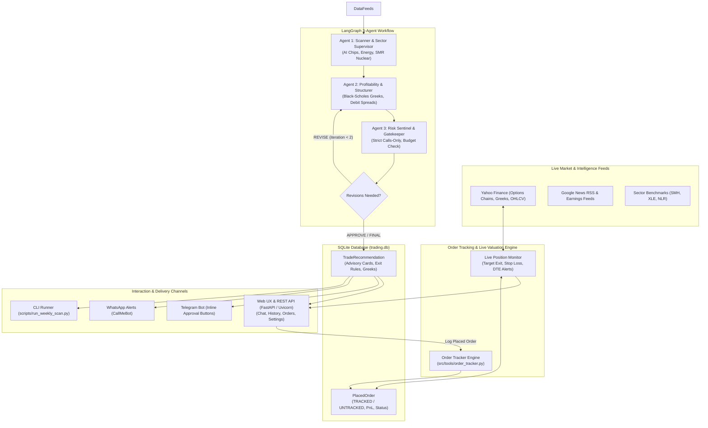

# Antigravity Options AI — Architecture, Installation & Configuration Guide

---

## 1. Executive Summary & Overview

**Antigravity Options AI** is an institutional-grade, multi-agent options advisory, execution, and portfolio tracking engine designed for defined-risk capital deployment.

### Key Pillars:
1. **Zero-Margin & Zero-Share Guardrail:** Strictly limits trade ideas to defined-risk buyer positions (`LONG_CALL` and `CALL_DEBIT_SPREAD`). All single-leg puts, naked options, and short-selling strategies are permanently banned. You never need to own 100 shares of underlying stock, and you never need margin.
2. **Independent Per-Trade Budget Cap:** Each trade is sized independently within your weekly budget ceiling (e.g. $\le \$500$). The system surfaces and ranks the highest-conviction opportunities so you can select the trade that best fits your strategy.
3. **Thematic Sector Intelligence:** Real-time screening across 3 structural US mega-trends:
   - **AI, Chips & Data Center Hardware** (SMH benchmark)
   - **Geopolitical Natural Gas & Energy War Hedge** (XLE benchmark)
   - **Small Modular Nuclear Reactors (SMRs) & Grid Power** (XLU / NLR benchmark)
4. **Order Tracking & Live Position Monitoring:** Log actual orders placed in your brokerage into the database, toggle `TRACKED` vs `UNTRACKED` states, update PnL on demand, and automatically monitor positions against 4 exit rules.
5. **Interactive Web Dashboard & Chat Assistant:** Single-page web dashboard powered by **Claude Haiku 5.5** featuring an interactive chat assistant, date-grouped recommendation history, date-grouped placed order portfolio with live PnL, and live runtime settings management.

---

## 2. System Architecture



---

## 3. Database Schema

The SQLite database (`data/trading.db`) runs in **WAL mode** (Write-Ahead Logging) for high concurrency and zero lock contention.

### 1. `trade_recommendations` Table
| Column | Type | Description |
| :--- | :--- | :--- |
| `id` | INTEGER PK | Auto-incrementing recommendation ID |
| `uuid` | VARCHAR(36) | Globally unique identifier |
| `symbol` | VARCHAR(10) | Stock ticker (e.g. `XOM`, `NVDA`, `OKLO`) |
| `structure` | VARCHAR(40) | `LONG_CALL` or `CALL_DEBIT_SPREAD` |
| `strike_price` | FLOAT | Long contract strike |
| `expiration_date`| DATE | Option expiration date |
| `entry_price_estimate` | FLOAT | Estimated net debit premium per share |
| `target_exit_price` | FLOAT | Profit target price (+30% to +50%) |
| `stop_loss_price` | FLOAT | Stop-loss price (-20% to -25%) |
| `estimated_profit_usd` | FLOAT | Expected dollar gain per contract |
| `max_cost` | FLOAT | Total dollar investment (cost $\le$ budget) |
| `delta`, `gamma`, `theta`, `vega`, `implied_volatility` | FLOAT | Black-Scholes risk metrics |
| `confidence_rating`, `confidence_score_pct` | STRING / FLOAT | Conviction ranking (e.g. HIGH, 75%) |
| `why_selected`, `when_to_buy`, `sell_conditions`, `early_warning_signs` | TEXT | Actionable institutional trade commentary |
| `status` | ENUM | `PENDING_APPROVAL`, `APPROVED`, `REJECTED`, `EXECUTED` |

### 2. `placed_orders` Table
| Column | Type | Description |
| :--- | :--- | :--- |
| `id` | INTEGER PK | Auto-incrementing order ID |
| `recommendation_id` | INTEGER FK | Linked recommendation (optional) |
| `symbol` | VARCHAR(10) | Stock ticker |
| `structure` | VARCHAR(40) | Option structure |
| `strike_price` | FLOAT | Strike price |
| `expiration_date` | DATE | Expiration date |
| `contracts` | INTEGER | Number of contracts bought |
| `fill_price` | FLOAT | Actual executed premium per share |
| `total_cost` | FLOAT | Total capital deployed (`fill_price * 100 * contracts`) |
| `current_price` | FLOAT | Latest option quote per share |
| `current_value` | FLOAT | Current position value (`current_price * 100 * contracts`) |
| `pnl` | FLOAT | Current profit / loss in USD |
| `pnl_percent` | FLOAT | Return on investment percentage |
| `tracking_status`| VARCHAR(20) | **`TRACKED`** (default) or **`UNTRACKED`** |
| `status` | VARCHAR(20) | `OPEN`, `CLOSED`, `CANCELLED` |
| `notes` | TEXT | Order notes & execution rationale |
| `placed_at`, `closed_at` | DATETIME | Execution timestamps |

---

## 4. Local Installation Guide

### Prerequisites
- **macOS or Linux** (x86_64 or Apple Silicon ARM64)
- **Python 3.11+**
- **uv** (recommended for ultra-fast packaging):
  ```bash
  curl -LsSf https://astral.sh/uv/install.sh | sh
  ```

### Step 1: Clone and Navigate to Directory
```bash
git clone <repo-url>
cd stocks/trading_agents
```

### Step 2: Create Virtual Environment & Install Dependencies
```bash
# Using uv (sub-second installation)
uv venv .venv
source .venv/bin/activate
uv pip install -e .
```

### Step 3: Configure Environment Variables
Copy the template and edit `.env`:
```bash
cp .env.example .env
```
Fill in your API keys:
```ini
# Primary LLM (Claude Haiku 5.5)
ANTHROPIC_API_KEY="sk-ant-..."
ANTHROPIC_MODEL="claude-haiku-5-5"
LLM_PROVIDER="anthropic"
ENABLE_LLM_FALLBACK=false

# Budget Controls
WEEKLY_BUDGET_USD=500.0
MAX_COST_PER_TRADE_USD=500.0
TARGET_GAIN_PERCENT=50.0
STOP_LOSS_PERCENT=25.0

# Notifications
NOTIFICATION_CHANNEL="WHATSAPP"
WHATSAPP_PHONE="+1234567890"
WHATSAPP_API_KEY="your_callmebot_key"
```

---

## 5. Running the Application

### 1. Launch the Interactive Web UX & API
```bash
python scripts/start_web.py --port 8000
```
Open **[http://127.0.0.1:8000](http://127.0.0.1:8000)** in your browser.
* **Prompt the Agent:** Chat with Claude Haiku 5.5 to log orders, check PnL, or request live monitoring.
* **Recommendations Tab:** View historical recommendations filtered by timeframe (`Last 7 Days`, `Last 14 Days`, `Last Month`, `Quarter`, `Year`, `All`) grouped by date. Click *"I Placed This Order"* to prefill and record a trade.
* **Placed Orders Tab:** View live open positions, click *"Monitor Live"* to refresh quotes, toggle `TRACKED` / `UNTRACKED`, and update PnL.
* **Settings Tab:** Adjust budget ceilings, change models, or update API keys with instant reload.

### 2. Run a Weekly Options Scan via CLI
```bash
# Full scan with default $500 budget
python scripts/run_weekly_scan.py

# Custom symbols and budget override
python scripts/run_weekly_scan.py --symbols NVDA OKLO XOM --budget 500

# Dry run (skips database persistence and notifications)
python scripts/run_weekly_scan.py --dry-run
```

### 3. Start the Telegram Bot Daemon
```bash
python scripts/start_bot.py
```
Interact via `/scan`, `/budget 750`, `/status`, and receive instant inline approval buttons on your phone.

---

## 6. Docker Containerization & Cloud Deployment

### 1. Running Locally with Docker Compose
The system is fully containerized with `Dockerfile` and `docker-compose.yml`.

```bash
# Build and start the Web UI service
docker compose up --build web

# Run in detached background mode
docker compose up -d web
```
The Web Dashboard will be available at **`http://localhost:8000`**, with persistent SQLite data stored in `./data`.

### 2. Running a Scan Inside Docker
```bash
docker compose run --rm weekly-scan
```

### 3. Deploying to Cloud Providers

#### A. Google Cloud Run (Serverless Container)
```bash
# Build and push image to Google Artifact Registry
gcloud builds submit --tag gcr.io/YOUR_PROJECT_ID/antigravity-options-ai

# Deploy container
gcloud run deploy antigravity-options \
  --image gcr.io/YOUR_PROJECT_ID/antigravity-options-ai \
  --platform managed \
  --region us-central1 \
  --allow-unauthenticated \
  --set-env-vars ANTHROPIC_API_KEY=sk-ant-...,WEEKLY_BUDGET_USD=500.0
```

#### B. Railway (Recommended Cloud Postgres + REST API)
See the full deployment and REST API guide in [RAILWAY_DEPLOYMENT.md](./RAILWAY_DEPLOYMENT.md):
1. Connect your GitHub repository and add a **Railway PostgreSQL** service in the same project.
2. Link `DATABASE_URL` (`${{Postgres.DATABASE_URL}}`), set `ANTHROPIC_API_KEY` and `API_KEY` in Railway Variables.
3. Railway uses `railway.toml` + `Dockerfile`, initializes Postgres tables automatically, binds `$PORT`, and checks `/health`.

---

## 7. Configuration Reference (`.env`)

| Variable | Default | Description |
| :--- | :--- | :--- |
| `ANTHROPIC_API_KEY` | `""` | Anthropic Console developer key (`sk-ant-...`) |
| `ANTHROPIC_MODEL` | `"claude-haiku-5-5"` | Model identifier (`claude-haiku-5-5`, `claude-3-5-sonnet-latest`) |
| `LLM_PROVIDER` | `"anthropic"` | Primary engine: `anthropic` or `gemini` |
| `ENABLE_LLM_FALLBACK` | `false` | When false, calls fail-fast with zero fallback |
| `WEEKLY_BUDGET_USD` | `500.0` | Maximum capital budget across active trades |
| `MAX_COST_PER_TRADE_USD`| `500.0` | Single position cost ceiling |
| `TARGET_GAIN_PERCENT` | `50.0` | Target profit exit (+50% default) |
| `STOP_LOSS_PERCENT` | `25.0` | Stop-loss limit (-25% default) |
| `NOTIFICATION_CHANNEL` | `"WHATSAPP"` | `WHATSAPP`, `TELEGRAM`, `BOTH`, or `NONE` |
| `WHATSAPP_PHONE` | `""` | Phone number with country code (e.g. `+14155552671`) |
| `WHATSAPP_API_KEY` | `""` | Personal CallMeBot API key |
| `TELEGRAM_BOT_TOKEN` | `""` | Telegram BotFather token |
| `TELEGRAM_CHAT_ID` | `""` | Authorized chat ID |
| `DATABASE_URL` | `"sqlite:///./data/trading.db"` | SQLite connection string with WAL mode |
